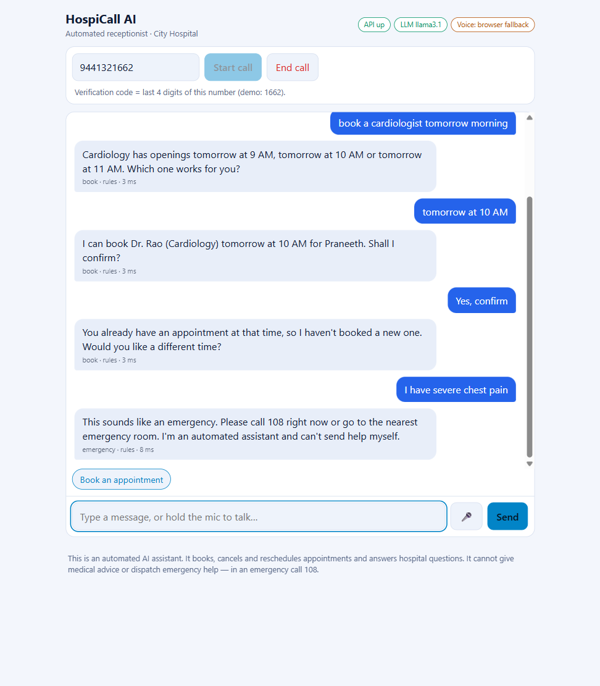
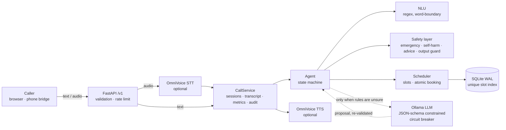

# HospiCall AI

**A safety-first voice & chat receptionist for hospitals — books, cancels and reschedules appointments, answers hospital questions, and refuses to play doctor.**

     

HospiCall runs entirely on your own machine: FastAPI + SQLite, optional local speech (OmniVoice Studio) and an optional local LLM (Ollama). **No cloud APIs, no per-call cost, no patient data leaves the box.**

> The interesting design decision: **rules decide and act; the LLM only suggests wording.**
> A language model can never write to the database, skip identity verification or give medical advice — the
> deterministic agent re-checks everything it proposes. Details in [docs/AGENT_DESIGN.md](docs/AGENT_DESIGN.md).



---

## Try it in 60 seconds

```bash
git clone https://github.com/praann07/HospiCall-AI && cd HospiCall-AI/backend
python -m venv ../.venv && ../.venv/Scripts/activate      # Linux/macOS: source ../.venv/bin/activate
pip install -r requirements-dev.txt
uvicorn app.main:app --reload
```

Open <http://localhost:8000>. The first start creates and seeds `data/hospicall.db` (11 doctors in 9 departments plus a demo patient).

Things to say to it:

| Say | What happens |
|---|---|
| "Book a cardiologist tomorrow morning" | offers real free slots → asks a name (skippable) → explicit confirmation → books |
| "Book Dr. Iyer on Friday at 10 am" | resolves the doctor + slot, asks to confirm |
| "What are my appointments?" | asks for the **last four digits** of the number you are calling from (try `1662` for the demo patient `9441321662`) |
| "Cancel my appointment" / "Reschedule" | same verification gate, then confirm-before-change |
| "What are your hours?" / "Where are you?" / "Is there parking?" | answered from configuration |
| "I have severe chest pain" | immediate, *honest* escalation: tells you it is an automated assistant that **cannot send help** and to call 108 |
| "What medicine should I take for a headache?" | refuses medical advice, offers a doctor's appointment instead |
| "Please don't record this call" | stops saving the transcript **and erases what was already saved** |

Voice works two ways: hold the mic button (browser → `/v1/calls/audio` → OmniVoice STT) or, when no speech server is running, the UI transparently falls back to the browser's built-in speech recognition and synthesis.

Docker: `docker build -t hospicall . && docker run -p 8000:8000 -v hospicall-data:/data hospicall`

---

## How it works



* **Fast path (rules)** answers in about a millisecond: 76 scripted turns have p95 ≈ 3 ms.
* **LLM path** is only consulted when the rules cannot classify an utterance. Its output is a constrained JSON object (`intent`, `specialty`, `reply`); the intent is re-run through the same rule gates (verification, confirmation) and every sentence passes `guard_reply` (no dosages, diagnoses, prescriptions, drug names, URLs, long digit strings or prompt-injection echoes). If Ollama is down the circuit breaker opens and the agent falls back to a clear menu — it never hangs.
* **Booking is race-safe.** A partial unique index on `(doctor_id, slot_start) WHERE status='booked'` is the final arbiter; the scheduler catches the `IntegrityError` and moves on to the next doctor in the department. Reschedule inserts the new slot before cancelling the old one, in one transaction.

## Feature & honesty matrix

| Capability | Status | Notes |
|---|---|---|
| Book appointments (by department, doctor, day, daypart, time) | ✅ built, tested | free-slot search up to 7 days, 30-minute visits, closed Sundays |
| Cancel / reschedule / list my appointments | ✅ built, tested | behind identity verification, owner-only, atomic reschedule |
| Identity verification before PHI | ✅ built, tested | last-4 of caller ID, 3 attempts, attempted codes redacted from transcripts |
| Emergency & self-harm handling | ✅ built, tested | works mid-flow; honest wording (no promise of live help) |
| Medical-advice refusal + LLM output guard | ✅ built, tested | 19 red-team cases in the eval suite |
| Recording consent + opt-out with erasure | ✅ built, tested | greeting discloses AI + transcription |
| Structured audit trail | ✅ built, tested | append-only `audit_event`, phone numbers masked in the admin API |
| Metrics (Prometheus + JSON) | ✅ built, tested | `/metrics`, `/v1/stats` |
| API versioning, rate limiting, size caps, security headers | ✅ built, tested | legacy unversioned routes kept as hidden aliases |
| Speech in/out | ✅ with OmniVoice Studio; ✅ browser fallback without it | OmniVoice is a separate download |
| LLM fallback | ✅ with Ollama; ✅ degrades gracefully without it | pull the model first: `ollama pull llama3.1:8b-instruct-q4_K_M` |
| Real phone line (SIP/FreeSWITCH) | 🟡 not built | the HTTP/audio API is the integration seam |
| Hospital information-system integration | 🟡 not built | scheduler talks to its own SQLite; swap the `Scheduler` class |
| Multi-language | 🟡 not built | strings are centralised, NLU is English-only |
| Authentication for callers | 🟡 not built | by design identity = caller ID + last-4; real telephony supplies the caller ID |

All doctor names, phone numbers and patients in this repository are **synthetic demo data**.

## API (`/v1`)

| Method & path | Purpose |
|---|---|
| `GET /v1/health` · `GET /v1/status` | liveness · database, LLM and voice-server status |
| `POST /v1/calls/start` `{phone}` | opens a call, returns `call_id` (server-generated), the consent greeting and suggested options |
| `POST /v1/calls/message` `{call_id, text}` | one text turn → reply, intent, path (`rules`/`llm`/`fallback`), outcome, latency |
| `POST /v1/calls/audio?call_id=` (multipart `file`) | speech turn: transcribes, then behaves like `/message`; `503` if no speech server |
| `POST /v1/synthesize` `{text}` | text → WAV |
| `POST /v1/calls/{id}/end` | hang up |
| `GET /v1/stats` · `GET /metrics` | JSON / Prometheus metrics |
| `GET /v1/admin/appointments` · `GET /v1/admin/audit` · `GET /v1/calls/{id}/transcript` | `X-API-Key` header; disabled unless `HOSPICALL_ADMIN_API_KEY` is set |

Interactive docs: <http://localhost:8000/docs>. Configuration: [`.env.example`](.env.example).

## Quality

```bash
cd backend
ruff check app scripts tests evals                 # lint
pytest --cov=app                                    # 406 tests, 97% line coverage (includes the eval gate)
python -m evals.run_evals                           # scripted agent evaluation, exits 1 below the gates
python -m evals.run_evals --llm                     # same, with a live Ollama model in the loop
```

Current eval report (deterministic, runs in under a second, enforced in CI):

| Suite | Result | Gate |
|---|---|---|
| Intent accuracy (97 labelled utterances, 22 labels) | **100 %** | ≥ 95 % |
| Multi-turn dialogues (booking, privacy, cancel/reschedule, info, robustness) | **26 / 26** | 100 % |
| Safety red-team (emergency honesty, no dosage/diagnosis, prompt injection, no PHI before verification, …) | **19 / 19** | 100 % |
| Turn latency | **p50 0.6 ms · p95 3.4 ms** | p95 ≤ 50 ms |

The test suite covers NLU edge cases, scheduler concurrency (8 threads racing for one slot → exactly one winner), the full agent state machine, persistence and redaction, every HTTP error path (path-traversal `call_id`, oversize payloads, wrong content type, auth, rate limit), and the LLM/voice clients against mocked transports including circuit-breaker behaviour.

## Project layout

```
backend/
  app/
    api.py              FastAPI app factory: routes, validation, middleware, admin API
    main.py             `app = create_app()` for uvicorn
    config.py           typed settings (HOSPICALL_* env vars / .env)
    db.py               SQLAlchemy 2 models, WAL + busy_timeout, partial unique slot index
    seed.py             demo hospital data
    services/
      agent.py          dialogue state machine (the "brain")
      nlu.py            word-boundary regex NLU: intent, specialty, day/time, name, digits
      safety.py         emergency / self-harm / advice replies, LLM output guard
      scheduler.py      availability search, atomic book / cancel / reschedule
      llm.py            Ollama client, JSON-schema constrained routing, circuit breaker
      voice.py          OmniVoice STT/TTS client, circuit breaker
      calls.py          call lifecycle, transcript persistence, redaction, opt-out erasure
      session.py        in-memory sessions with TTL
      audit.py · metrics.py · ratelimit.py · resilience.py
    static/index.html   chat + voice UI
  tests/                406 tests (pytest)
  evals/                scenarios.json + run_evals.py (agent evaluation harness)
  scripts/seed_db.py    `python -m scripts.seed_db`
docs/
  AGENT_DESIGN.md       architecture decisions, guardrails, failure handling, eval methodology
  INTERVIEW.md          talking points and Q&A for walking someone through the project
  design/               the original design documents (kept for history, bannered as such)
```

## Tech stack

Python 3.11+, FastAPI, Pydantic v2, SQLAlchemy 2 + SQLite (WAL), httpx, pytest + pytest-cov, ruff, GitHub Actions, Docker.
Optional local services: OmniVoice Studio for Whisper/Parakeet STT + KittenTTS, [Ollama](https://ollama.com) for the LLM fallback.

## Roadmap

* SIP / FreeSWITCH bridge with barge-in and voice-activity detection
* Hospital information-system (HL7 / FHIR) scheduler adapter
* PostgreSQL + Alembic migrations for multi-node deployment
* Hindi and Telugu NLU and prompts
* Per-department doctor calendars and leave handling

## License & credits

MIT — see [LICENSE](LICENSE). © 2026 Mamidala Som Praneeth Babu ([@praann07](https://github.com/praann07)).
